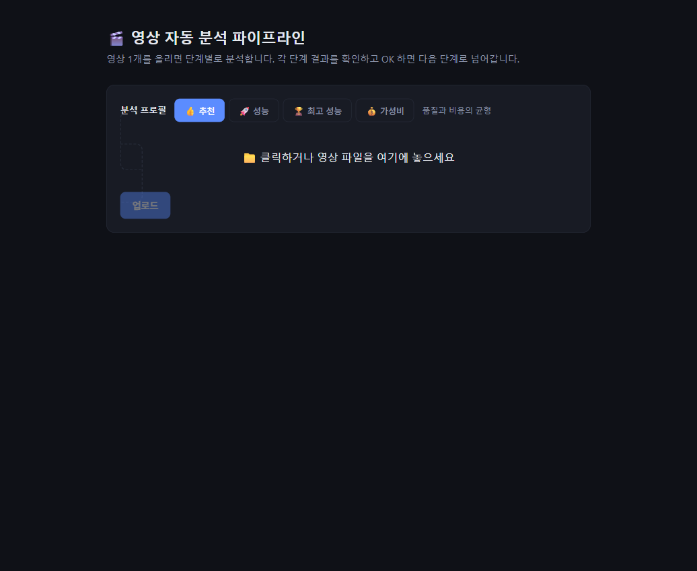
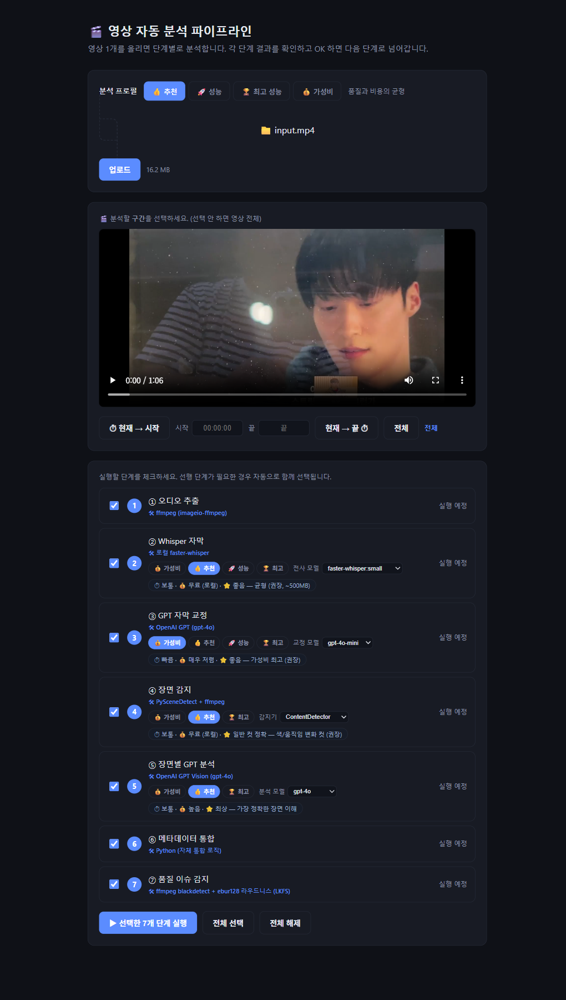
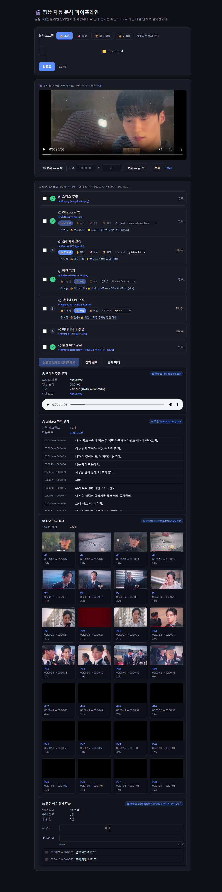

# 🎬 영상 자동 분석 파이프라인

영상 파일 1개를 업로드하면 **오디오 추출 → 자막 생성 → 자막 교정 → 장면 감지 → 장면 분석 → 메타데이터 통합 → 품질 검사**를 단계별로 수행하는 웹 애플리케이션입니다. 각 단계 결과를 **시각적으로** 확인하고, 원하는 단계만 골라 실행할 수 있습니다.

---

## 📸 스크린샷

### 1. 시작 화면 — 분석 프로필 선택 + 업로드
업로드 전에 **추천 / 성능 / 최고 성능 / 가성비** 프로필을 골라 모든 단계의 AI 모델을 한 번에 설정할 수 있습니다.



### 2. 단계 설정 — 구간 선택 + 단계별 모델/티어
영상에서 **분석할 구간**을 지정하고, 각 단계마다 **성능 티어(💰가성비·👍추천·🚀성능·🏆최고)** 와 모델을 직접 선택합니다. 선택 시 **속도·비용·품질** 정보가 표시됩니다.



### 3. 분석 결과 — 단계별 시각화
오디오 플레이어, 자막 타임라인, 장면 썸네일 그리드, 품질 이슈 타임라인까지 결과가 시각적으로 표시됩니다.



---

## ✨ 주요 기능

- **7단계 파이프라인** — 단계별로 실행하고 결과를 즉시 확인
- **단계 선택 실행** — 체크박스로 원하는 단계만 실행 (선행 단계 자동 포함)
- **구간 선택** — 영상의 특정 부분만 잘라서 분석
- **모델/툴 직접 선택** — 단계마다 모델·감지기를 고르고 속도/비용/품질 비교
- **분석 프로필** — 추천/성능/최고 성능/가성비 프리셋으로 일괄 설정
- **로컬 Whisper** — `faster-whisper`로 무료·오프라인 자막 생성
- **타임코드 보존** — 교정·통합 단계에서 타임스탬프를 절대 변경하지 않음
- **품질 이슈 감지** — 블랙 화면 + 음성 튐(LKFS 라우드니스 기반)

---

## 🔧 처리 단계

| 단계 | 내용 | 사용 툴 | 출력 |
|------|------|---------|------|
| ① 오디오 추출 | 영상 → 16kHz mono WAV | ffmpeg | `audio.wav` |
| ② Whisper 자막 | 음성 → 타임코드 자막 | 로컬 faster-whisper (또는 OpenAI) | `original.srt` |
| ③ GPT 자막 교정 | 오탈자/맞춤법 교정 (타임코드·구두점 보존) | OpenAI GPT | `corrected.srt` |
| ④ 장면 감지 | 컷 감지 + 대표 프레임 | PySceneDetect + ffmpeg | 썸네일 |
| ⑤ 장면별 GPT 분석 | 장면 요약·키워드·분위기 | OpenAI GPT (Vision) | 분석 데이터 |
| ⑥ 메타데이터 통합 | 장면+자막+분석 결합 | Python | `scenes.json` |
| ⑦ 품질 이슈 감지 | 블랙 화면 + 음성 튐 | ffmpeg blackdetect + ebur128 (LKFS) | `quality_issues.json` |

---

## 🚀 설치 및 실행

### 1) 요구 사항
- Python 3.11+ (개발/테스트: 3.14)
- ffmpeg는 별도 설치 불필요 — `imageio-ffmpeg` 번들 바이너리 사용

### 2) 의존성 설치
```bash
pip install -r requirements.txt
```

### 3) API 키 설정 (`.env`)
`.env.example`을 복사해 `.env`를 만들고 키를 입력합니다.
```env
OPENAI_API_KEY=sk-...      # ③ 교정, ⑤ 분석에 필요
WHISPER_MODEL=whisper-1    # ② OpenAI API 사용 시
GPT_MODEL=gpt-4o
SCENE_THRESHOLD=27.0
```
> ② Whisper를 **로컬 faster-whisper**로 쓰면 OpenAI 키 없이도 자막 생성이 가능합니다. ③·⑤(GPT)만 키가 필요합니다.

### 4) 서버 실행
```bash
python -m uvicorn main:app --app-dir backend --host 127.0.0.1 --port 8000
```
브라우저에서 **http://127.0.0.1:8000** 접속.

---

## 🖱 사용 방법

1. **분석 프로필** 선택 (추천/성능/최고 성능/가성비)
2. **영상 업로드**
3. (선택) **구간 지정** — 플레이어에서 `현재 → 시작/끝` 또는 시간 직접 입력
4. 실행할 **단계 체크** + 단계별 **모델/티어** 조정
5. **`▶ 선택한 단계 실행`** 클릭 → 단계별 결과가 순서대로 표시
6. 완료 후 `original.srt` / `corrected.srt` / `scenes.json` 다운로드

### 분석 프로필별 모델

| 프로필 | ② 전사 | ③ 교정 | ⑤ 분석 | ④ 장면 |
|--------|--------|--------|--------|--------|
| 💰 가성비 | faster-whisper:base | gpt-4o-mini | gpt-4o-mini | — |
| 👍 추천 | faster-whisper:small | gpt-4o-mini | gpt-4o | — |
| 🚀 성능 | faster-whisper:medium | gpt-4.1 | gpt-4o | — |
| 🏆 최고 성능 | faster-whisper:large-v3 | gpt-4.1 | gpt-4.1 | AdaptiveDetector |

---

## 📁 프로젝트 구조

```
ai 영상분석/
├─ .env / .env.example / .gitignore
├─ requirements.txt
├─ README.md
├─ screenshots/                # README용 스크린샷
├─ backend/
│  ├─ main.py                  # FastAPI 앱 (업로드·단계 실행·결과 제공)
│  ├─ config.py                # .env 로드
│  ├─ pipeline/
│  │  ├─ orchestrator.py       # 단계/프리셋/티어 정의 + 실행 제어
│  │  ├─ s1_audio.py           # ① 오디오 추출 + 구간 클립
│  │  ├─ s2_whisper.py         # ② OpenAI Whisper API
│  │  ├─ s2_whisper_local.py   # ② 로컬 faster-whisper
│  │  ├─ s3_correct.py         # ③ GPT 교정 (타임코드/구두점 보존)
│  │  ├─ s4_scenes.py          # ④ 장면 감지 + 썸네일
│  │  ├─ s5_analyze.py         # ⑤ 장면별 GPT 분석
│  │  ├─ s6_merge.py           # ⑥ 메타데이터 통합
│  │  └─ s7_quality.py         # ⑦ 블랙/음성 튐 감지
│  └─ utils/srt.py             # SRT 파싱/직렬화 (타임코드 보존)
├─ frontend/index.html         # 단일 페이지 UI
└─ work/{job_id}/              # 작업/출력 폴더 (gitignore)
```

---

## 🔒 핵심 제약

- **타임코드 수정 금지** — ② Whisper / ④ 장면 감지에서 나온 타임스탬프를 ③·⑥에서 그대로 전파합니다. GPT 교정은 텍스트만 보내고 받아 원본 타임코드에 재결합하며, 끝맺음 구두점도 원문을 유지합니다.
- **API 키는 `.env`** — 코드/저장소에 키를 포함하지 않습니다 (`.gitignore` 처리).

---

## 📊 출력 예시 (`scenes.json`)

```jsonc
{
  "video": "input.mp4",
  "duration": "00:01:06",
  "scene_count": 12,
  "subtitle_count": 16,
  "scenes": [
    {
      "scene_no": 1,
      "start": "00:00:00,000",
      "end": "00:00:04,600",
      "summary": "...",
      "keywords": ["..."],
      "mood": "...",
      "subtitles": [
        { "start": "00:00:00,000", "end": "00:00:04,600", "text": "..." }
      ]
    }
  ]
}
```

---

## 💡 토큰/비용 절감 팁

- ⑤ 분석·③ 교정에 **mini 모델** 사용 (가성비 프로필)
- 필요한 **단계만 선택** 실행 (자막만 필요하면 ④⑤ 생략)
- ② Whisper를 **로컬 모델**로 사용 → API 비용 0
- **구간 선택**으로 분석 범위를 줄이기
